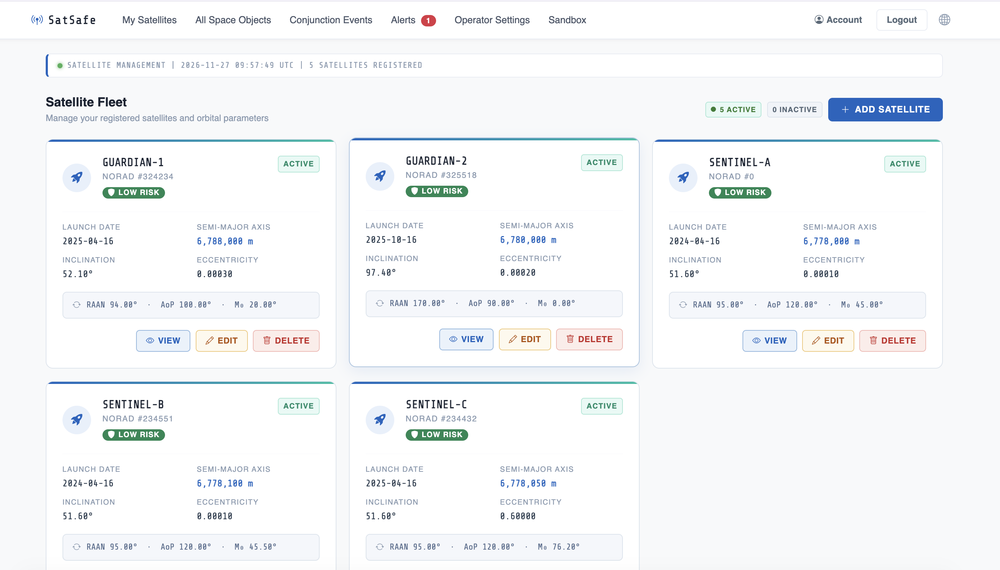
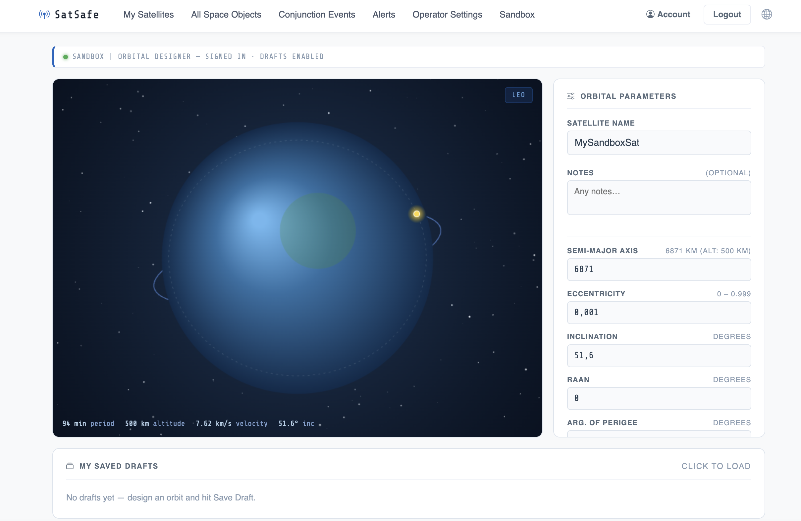

# SatSafe – Space Situational Awareness Platform

A web platform for space situational awareness: monitor satellites and debris, manage a satellite fleet, and screen for potential conjunction (close-approach) events.

Built as a learning project to practise software engineering in a domain I love. Orbital models and data are simplified and **not intended for operational use**.

React front-end: [link]


## Features

**Public**
- Live overview of tracked objects: active satellites and debris
- Catalogue of all space objects
- **Orbital sandbox**: design an orbit from Keplerian elements (semi-major axis, eccentricity, inclination, RAAN, argument of perigee) and see it visualised, with calculated period, altitude and velocity

**Users**
- Save sandbox orbit designs as drafts

**Operators**
- Dashboard with orbital view, live alerts and conjunction timeline
- Satellite fleet management: add, edit and delete satellites with their orbital parameters
- Conjunction events and risk alerts
- Operator settings

**Platform**
- Role-based authentication (User / Operator)
- Multi-language support

## Screenshots
| Operator dashboard | Satellite fleet | Orbital sandbox |
|---|---|---|
|  |  |  |

## How it works

**Conjunction screening**
Each object's Keplerian orbit is propagated forward over a 24-hour window. Every pair of objects is checked with a two-pass search:
1. **Coarse pass** – sample positions every 60 s to find the approximate time of closest approach (TCA)
2. **Fine pass** – resample ±1 step around that TCA at 1 s resolution to get the miss distance

Pairs whose miss distance falls below the threshold (default 5 km) become conjunction events.

**Orbital risk score**
A satellite's risk score counts how many other objects share an overlapping altitude band (perigee–apogee) and a similar inclination (within 15°). The score is normalised to 0–1 and saturates at 50 neighbouring objects.

## Architecture
Layered clean architecture:

- **App.Domain** – core entities, value objects and domain services (orbital mechanics, conjunction screening, risk scoring)
- **App.Application** – use cases and business logic
- **App.Infrastructure** – data access with Entity Framework Core
- **App.Resources** – localisation
- **WebApp** – ASP.NET Core web app and REST API
- **App.Tests** – automated tests
- **Base.*** – reusable generic building blocks shared across layers

## Tech
C# · ASP.NET Core · Entity Framework Core · [database] · Docker · [test framework]

## Run locally
```
[docker compose up / dotnet run --project WebApp]
```
Then open http://localhost:[PORT]

## Tests
```
dotnet test
```

## Limitations
- Two-body Keplerian propagation only (no J2, atmospheric drag or other perturbations)
- O(n²) pairwise screening – fine for small catalogues, not for thousands of objects
- Risk score is a simple heuristic, not a collision probability

## AI-assisted development
AI tools were used to help implement parts of the orbital mechanics and screening algorithms. I reviewed, tested and adjusted the generated code.
