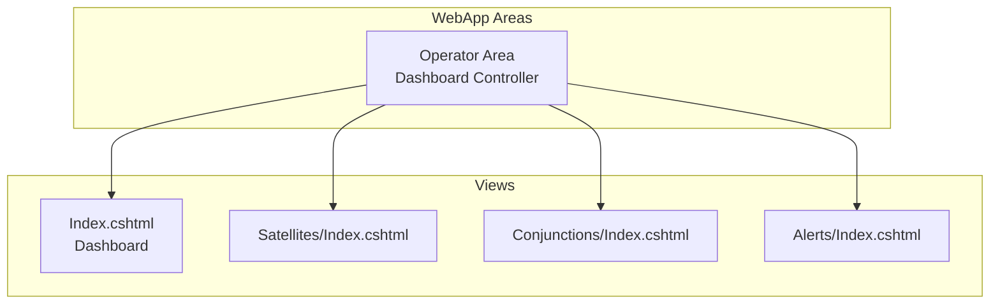

# Operator Dashboard Implementation Plan

## Overview

Create an operator dashboard page in the SSA Platform that allows authenticated operators to manage their satellites, conjunction events, and alerts. The implementation will follow the existing structure and styling conventions from [`Index.cshtml`](WebApp/Views/Home/Index.cshtml).

## Authorization Requirements

Authorization will require **both**:
1. User must be authenticated (signed in)
2. User must have the "Operator" role via `AppRole`
3. User must have a linked `Operator` record in the `UserOperator` table

This ensures operators are authorized space entity operators with a relationship to an operator organization.

## Architecture



## File Structure

```
WebApp/
├── Areas/
│   └── Operator/
│       ├── Controllers/
│       │   └── DashboardController.cs
│       └── Views/
│           ├── _ViewStart.cshtml
│           ├── _ViewImports.cshtml
│           ├── Dashboard/
│           │   └── Index.cshtml
│           ├── Satellites/
│           │   └── Index.cshtml
│           ├── Conjunctions/
│           │   └── Index.cshtml
│           └── Alerts/
│               └── Index.cshtml
```

## Implementation Steps

### Step 1: Create Operator Area Structure

Create the `WebApp/Areas/Operator/` directory structure with:
- `Controllers/DashboardController.cs`
- `Views/Dashboard/Index.cshtml`
- `Views/Satellites/Index.cshtml`
- `Views/Conjunctions/Index.cshtml`
- `Views/Alerts/Index.cshtml`

### Step 2: Implement DashboardController

```csharp
// WebApp/Areas/Operator/Controllers/DashboardController.cs
[Area("Operator")]
[Authorize]  // Requires authenticated user
public class DashboardController : Controller
{
    private readonly AppDbContext _context;
    
    public DashboardController(AppDbContext context)
    {
        _context = context;
    }
    
    // Index action - main dashboard
    public async Task<IActionResult> Index()
    {
        // Verify user has Operator role AND UserOperator link
        var userId = User.FindFirstValue(ClaimTypes.NameIdentifier);
        var hasOperatorRole = User.IsInRole("Operator");
        var userOperator = await _context.UserOperators
            .Include(uo => uo.Operator)
            .FirstOrDefaultAsync(uo => uo.AppUserId == Guid.Parse(userId));
            
        if (!hasOperatorRole || userOperator == null)
        {
            return Forbid();  // Not authorized
        }
        
        // Get data for dashboard
        var operatorId = userOperator.OperatorId;
        var satellites = await _context.Satellites
            .Where(s => s.OperatorId == operatorId)
            .ToListAsync();
            
        // ... more data loading
            
        return View(model);
    }
}
```

### Step 3: Create Index.cshtml Dashboard View

Follow the same structure as [`WebApp/Views/Home/Index.cshtml`](WebApp/Views/Home/Index.cshtml:1-141):
- Use `container` class for layout
- Include hero section with welcome message
- Show statistics cards for assigned satellites
- Include quick-action buttons for satellite/conjunction/alert management

Key sections:
- Operator info banner
- Assigned satellites summary
- Active conjunction events summary
- Unacknowledged alerts summary

### Step 4: Create Satellites View

```razor
@* WebApp/Areas/Operator/Views/Satellites/Index.cshtml *@
@model IEnumerable<Satellite>

<div class="container">
    <h1>My Satellites</h1>
    <table class="table">
        <thead>
            <tr>
                <th>Name</th>
                <th>Norad ID</th>
                <th>Status</th>
                <th>Launch Date</th>
                <th>Actions</th>
            </tr>
        </thead>
        <tbody>
            @foreach (var sat in Model)
            {
                <tr>
                    <td>@sat.Name</td>
                    <td>@sat.NoradId</td>
                    <td>@sat.Status</td>
                    <td>@sat.LaunchDate.ToShortDateString()</td>
                    <td>
                        <a asp-action="Edit" asp-route-id="@sat.Id">Edit</a>
                    </td>
                </tr>
            }
        </tbody>
    </table>
</div>
```

### Step 5: Create Conjunctions View

Filter conjunction events to show only those involving the operator's satellites.

### Step 6: Create Alerts View

Show alerts for the current user's conjugated events, with ability to acknowledge.

### Step 7: Update Navigation

Add Operator section to [`_Layout.cshtml`](WebApp/Views/Shared/_Layout.cshtml:26-51):

```html
<li class="nav-item dropdown">
    <a class="nav-link dropdown-toggle" href="#" role="button"
       data-bs-toggle="dropdown" aria-expanded="false">
        Operator
    </a>
    <ul class="dropdown-menu">
        <li><a class="dropdown-item" asp-area="Operator" asp-controller="Dashboard" asp-action="Index">Dashboard</a></li>
        <li><a class="dropdown-item" asp-area="Operator" asp-controller="Satellites" asp-action="Index">Satellites</a></li>
        <li><a class="dropdown-item" asp-area="Operator" asp-controller="Conjunctions" asp-action="Index">Conjunctions</a></li>
        <li><a class="dropdown-item" asp-area="Operator" asp-controller="Alerts" asp-action="Index">Alerts</a></li>
    </ul>
</li>
```

## Styling Conventions

Follow the exact styling from [`Index.cshtml`](WebApp/Views/Home/Index.cshtml):
- Use Bootstrap 5 classes (`container`, `row`, `col-lg-6`, `card`, `btn`)
- Include orbit.css visualization styles
- Use consistent color scheme (primary, success, warning)
- Maintain responsive layout

## Dependencies

The implementation uses existing infrastructure:
- [`AppDbContext`](App.Infrastructure/Persistence/AppDbContext.cs) for database access
- [`Satellite`](App.Domain/Entities/Satellite.cs) entity
- [`ConjunctionEvent`](App.Domain/Entities/ConjunctionEvent.cs) entity
- [`Alert`](App.Domain/Entities/Alert.cs) entity
- [`UserOperator`](App.Domain/Entities/UserOperator.cs) entity for user-operator relationship

## Authorization Logic (Detailed)

```csharp
private async Task<bool> IsAuthorizedOperatorAsync(Guid userId)
{
    // 1. Check authentication
    if (!User.Identity?.IsAuthenticated ?? true)
        return false;
    
    // 2. Check AppRole "Operator"
    if (!await _userManager.IsInRoleAsync(await _userManager.FindByIdAsync(userId), "Operator"))
        return false;
    
    // 3. Check UserOperator link exists
    var userOperator = await _context.UserOperators
        .AnyAsync(uo => uo.AppUserId == userId);
    
    return userOperator;
}
```

The `[Authorize]` attribute handles authentication check, and the action method performs the additional role and relationship checks.

## Key Metrics for Dashboard

Display these statistics on the operator dashboard:
- Total assigned satellites
- Active satellites count
- Pending conjunction events
- Unacknowledged alerts